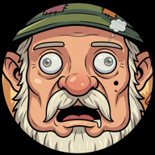

# Bob The Agent


A containerized autonomous agent that runs 24/7 via Docker Compose. A Python harness long-runner provides the FastAPI gateway, Discord bot, task loop and scheduler, while researcher/simple Hermes profiles and Ollama (LLM inference) run in the same stack.

## Features

- **Multi-Agent Architecture** — Researcher and simple task agents as Hermes profiles alongside the harness in a single container
- **Autonomous Operation** — Runs tasks without user interaction via Discord or CLI
- **Local & Cloud Models** — Uses Ollama for both local and cloud model inference
- **Web Search** — Built-in SearXNG metasearch engine (free, no API keys needed)
- **Skills** — X.com search, Grok search, AWS S3, data extraction, math operations, profile delegation
- **Discord Bot** — Chat with your agent through Discord
- **Delegation** — Harness delegates specialized tasks to the researcher and simple profiles in-process (no messaging transport)
- **Harness Long-Runner** — Python harness long-runner — FastAPI gateway on 8181, Discord bot, task loop, in-loop APScheduler; OpenCode invoked directly for coding tasks
- **Docker** — Easy deployment with Docker Compose

## Quick Start

### Prerequisites

- Docker Desktop or Docker Engine + Docker Compose v2
- Recommended at least 8GB RAM (4GB minimum)
- Optional: NVIDIA GPU for faster local inference if local models are used

### 1. Clone and Configure

```bash
git clone <repository-url>
cd bob-the-agent
cp .env.template .env
# Edit .env with your configuration
```

### 2. One-time Migration (existing installs)

If you have runtime data from a previous per-agent-container install (`volumes/agent-main`, `volumes/agent-researcher`, ...), migrate it into the new single-volume layout before the first start:

```bash
bash src/scripts/migrate-volumes.sh volumes volumes/agent
```

Only memories, cron jobs and workspace files are carried over per profile; configs, SOUL.md, skills and databases are regenerated by bootstrap. Old volumes are never modified. Fresh installs can skip this step.

### 3. Build Image & Start Services

`run-docker.sh` builds the single `bob-the-agent:latest` image (`dockerfiles/Dockerfile.hermes`) and runs `docker compose up -d`:

```bash
# Option A: Build and start separately
docker build -t bob-the-agent:latest -f dockerfiles/Dockerfile.hermes .
docker compose up -d

# Option B: Build and start in one command
./run-docker.sh

# Option C: Pull from registry (if available)
docker pull your-registry/bob-the-agent:latest
docker tag your-registry/bob-the-agent:latest bob-the-agent:latest
docker compose up -d
```

### 4. Pull Ollama Models

On first boot, bootstrap runs a best-effort `ollama pull` targeting the template default model `glm-5.3-flash:cloud` (capped at 30 minutes). That model is served in the cloud, so the pull is just a short manifest pull, not a large local download. Sign into Ollama and pull the manifests for the configured cloud models:

```bash
# Sign into Ollama for cloud models
docker exec -it bob-the-agent-ollama ollama signin

# Pull cloud model manifests
docker exec bob-the-agent-ollama ollama pull glm-5.3-flash:cloud
docker exec bob-the-agent-ollama ollama pull glm-5.3:cloud
docker exec bob-the-agent-ollama ollama pull kimi-k2.7-code:cloud
```

### 5. Verify Installation

```bash
# Check all containers are running
docker compose ps

# Check harness gateway health (API-key secured; loopback-bound by default)
curl http://localhost:8181/

# Check Ollama
curl http://localhost:11434/api/tags
```

### Host smoke verification

Run the smoke script on the **Docker host** (not inside a container):

```bash
./scripts/host-smoke.sh                 # full run
./scripts/host-smoke.sh --skip-build    # re-run without rebuilding the image
```

It performs six checks: image build, `docker compose up -d`, a poll of `http://127.0.0.1:8181/` for up to ~35 minutes (first boot may pull/bootstrap a model), the `starting harness (supervisord)` startup marker in the container logs, an in-container `import harness`, and `docker compose ps` showing all four services Up. Record results in [tests/SMOKE_LOG.md](tests/SMOKE_LOG.md).

> The `poc` branch is a proof-of-concept. It is **not pushed to any remote** — all work lives on the local `poc` branch only.

### 6. Configure Discord Bot (Optional)

Set `DISCORD_BOT_TOKEN` in `.env`, then restart:

```bash
docker compose restart agent
```

When asked to pair bot for the first time, you have to do it in the agent container using the hermes CLI and the pairing token provided by the bot through Discord:

```bash
docker exec -it bob-the-agent hermes pairing approve discord TOKEN
```

See [Discord Setup](docs/DISCORD_SETUP.md) for detailed instructions.

## Architecture

```
┌──────────────────────────────────────────────────────────────────┐
│                        Docker Compose                            │
│                                                                  │
│  ┌───────────┐                                                   │
│  │  ollama   │  LLM Inference (local + cloud models)             │
│  │  :11434   │                                                   │
│  └─────┬─────┘                                                   │
│        │                                                          │
│  ┌─────┴──────────────────────────────────────────────┐         │
│  │  agent (single container)                           │         │
│  │                                                     │         │
│  │  harness (:8181)                                    │         │
│  │  FastAPI gateway + Discord bot                      │         │
│  │  task loop + APScheduler                            │         │
│  │                                                     │         │
│  │  secondary profiles (multiplexed gateway):          │         │
│  │  ┌──────────┐ ┌────────┐                           │         │
│  │  │researcher│ │ simple │                           │         │
│  │  │ Research │ │ Simple │                           │         │
│  │  │          │ │ Tasks  │                           │         │
│  │  └──────────┘ └────────┘                           │         │
│  └────────────────────────────────────────────────────┘         │
│                                                                  │
│  ┌─────────────┐  ┌─────────┐  Web Search + Cache              │
│  │  SearXNG    │  │ Valkey  │                                   │
│  │   :8888     │◄─┤ :6379   │                                   │
│  └─────────────┘  └─────────┘                                   │
└──────────────────────────────────────────────────────────────────┘
```

See [ARCHITECTURE.md](docs/ARCHITECTURE.md) for detailed diagrams and documentation.

## Configuration

### Environment Variables

The harness gateway listens on `8181` (bound to `127.0.0.1` by default). It replaces the old main-profile `:8642` gateway; there is no `8080` gateway.

| Variable | Description | Default |
|----------|-------------|---------|
| `LOG_LEVEL` | Logging level | `info` |
| `DISCORD_BOT_TOKEN` | Discord bot token | - |
| `SEARXNG_BASE_URL` | SearXNG base url | `http://searxng:8888` |
| `HARNESS_API_KEY` | Required; API key securing the harness gateway (fail-fast). Generate one with: `openssl rand -hex 32` | (unset = startup FATAL) |
| `HARNESS_ROUTER_BASE_URL` | OpenAI-compatible router endpoint | `http://ollama:11434/v1` |
| `HARNESS_ROUTER_MODEL` | Router model | `glm-5.3-flash:cloud` |
| `HARNESS_DATA_DIR` | Harness state dir (in-container) | `/opt/data/harness` |
| `HARNESS_WORKDIR` | Harness working directory (in-container) | `/app/projects` |
| `HARNESS_DISCORD_HOME_CHANNEL` | Pinned Discord notices/home channel for the bot | (unset) |
| `USER_X_COM_API_TOKEN` | X.com API token | - |
| `USER_XAI_SEARCH_API_KEY` | xAI API key for Grok search | - |
| `USER_AWS_S3_BUCKET` | AWS S3 Bucket | - |
| `USER_AWS_S3_REGION` | AWS S3 Region | - |
| `USER_AWS_S3_ACCESS_KEY_ID` | AWS Access Key | - |
| `USER_AWS_S3_SECRET_ACCESS_KEY` | AWS Secret Key | - |

> **Harness API key:** an empty `HARNESS_API_KEY` makes supervisord hit `FATAL` at startup (`config.py` fail-fast). Generate one with `openssl rand -hex 32` and put it in `.env`.

> **Discord:** the bot requires the **MESSAGE CONTENT INTENT** enabled in the Discord developer portal. `discord_bot.py` sets `intents.message_content = True`; without the portal-side intent, `on_message` events carry no text.

### Agent Configuration

Each profile has its own configuration in `src/agents/{name}/hermes.partial.yml` that overrides the shared template at `src/config/hermes.template.yaml`. See [CONFIGURATION.md](docs/CONFIGURATION.md) for details.

### Volume Mounts

| Path | Purpose |
|------|---------|
| `./volumes/agent` | Single agent workspace: profiles under `profiles/` are researcher/simple only |
| `./volumes/projects` | Shared project workspace (git repos for coding tasks) |
| `./volumes/results` | Task output files |

## Skills

Built-in skills for:
- in-process delegation to the researcher/simple profiles
- OpenCode CLI integration (invoked directly for coding tasks)
- SearXNG web search capabilities
- x-com(Twitter) searching directly
- grok (xAI) search as an x-com fallback
- extracting data from URLs/documents and performing calculations.

Skills are standalone directories — there is no central skill runner and no build step. The agent invokes each skill directly with the commands documented in its SKILL.md:

```bash
node /app/skills/<skill>/cli.ts '<single-quoted JSON arguments>'   # TypeScript skills — Node runs .ts natively (type stripping)
python3 /app/skills/searxng-web-search/scripts/searxng_search.py   # Python (SearXNG) helper script
```

Each skill carries its own dependency manifest (`package.json`, or `requirements.txt` for Python) installed during the Docker build — the built container needs no skill prepare/build step.

## Development

### Project Structure

```
bob-the-agent/
├── compose.yaml              # Service orchestration
├── dockerfiles/
│   └── Dockerfile.hermes     # Hermes Agent container
├── src/
│   ├── agents/               # Agent definitions (researcher, simple)
│   │   ├── researcher/       # Research specialist
│   │   └── simple/           # Simple task handler
│   ├── config/               # Hermes and SearXNG configuration
│   ├── scripts/              # Container setup scripts
│   └── skills/               # Standalone skills, invoked directly per their SKILL.md
├── volumes/                  # Runtime data (per-agent workspaces)
└── docs/                      # Documentation
```

### Running the Test Suite

```bash
# Local (hermetic) suite — no stack or model calls
npm test

# Docker-gated suites against a running stack
DOCKER_TESTS=1 npx jest --runInBand --config tests/jest.config.js tests/docker-compose.test.ts tests/coder-agent.test.ts

# Add OLLAMA_LIVE_TESTS=1 to also run the live-inference delegation smoke
# (slow on CPU-only local inference — prefer verifying with cloud models)
```

### Building from Source

All agent services share a single `bob-the-agent:latest` image:

```bash
# Build the image
docker build -t bob-the-agent:latest -f dockerfiles/Dockerfile.hermes .

# Or build and start in one step
./run-docker.sh

# Rebuild after config changes (image is shared by all profiles)
docker build -t bob-the-agent:latest -f dockerfiles/Dockerfile.hermes .
docker compose up -d
```

## Documentation

- [Architecture](docs/ARCHITECTURE.md) — System architecture and data flow
- [Configuration](docs/CONFIGURATION.md) — Detailed configuration options
- [Installation](docs/INSTALLATION.md) — Setup instructions
- [Discord Setup](docs/DISCORD_SETUP.md) — Discord bot configuration
- [Troubleshooting](docs/TROUBLESHOOTING.md) — Common issues and solutions

## License

MIT License
